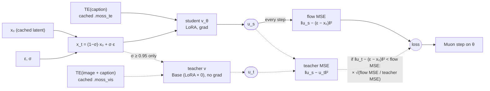
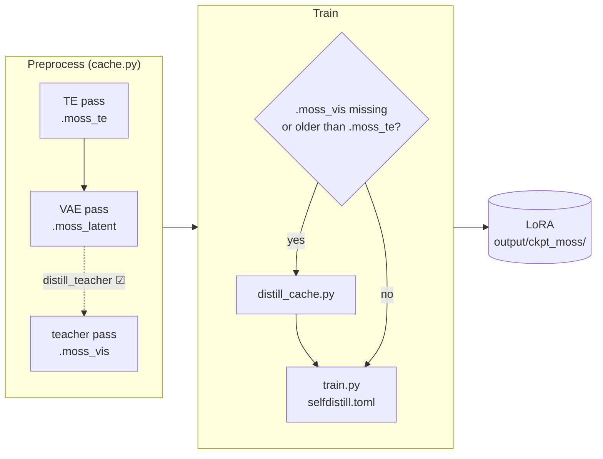

# Self-distilled LoRA (gated add95)

Status: experimental. Default since 2026-11-15: it replaces balanced hybrid95 (2026-11-14), which
replaced add90 ema97 (2026-11-09). Tested on caststation only (30 images, 480 steps); the
2,832-step sincos run below is the previous default's. Config: `configs/moss/selfdistill.toml`.
Earlier arms and their verdict: [`reports/self_distill_arms.md`](../reports/self_distill_arms.md);
why the EMA teacher was dropped: [`proposal/self_distill_lora.md`](../proposal/self_distill_lora.md);
the gate and the add form:
[`reports/caststation_casbox.md`](../reports/caststation_casbox.md#follow-up-2026-11-15-a-gated-teacher-lr-2e-4-a-band-limited-teacher).

A t2i LoRA trained with the plain flow loss on every step, plus a second term on steps at the
highest noise that pulls the prediction toward a teacher's velocity. The teacher is Base, given
the training image through Qwen3.5-9B's vision tower ahead of the caption. With the image in context, MOSS reproduces
the composition, outfits and layout of the target zero-shot
([vision_tower_reference.md](../findings/vision_tower_reference.md)). At σ ≥ 0.95 `x_t` holds
almost nothing of the image, so the flow target there asks the LoRA to memorise the training
composition. The teacher's velocity is how the model itself would draw that image. The term is
on only for samples where the teacher is closer to the flow target than the LoRA is, so it never
pulls a prediction that already beats it.

## The recipe



Solid edges run on every step; dotted ones on the ~9 % of steps at σ ≥ 0.95. The scale gives the
teacher term the flow term's gradient norm on the prediction. Unscaled, the teacher MSE is ~0.03
against a flow MSE of ~0.52 there, about a quarter of the gradient. The gate compares the two flow
losses on the same `x_t`; when the teacher's is the higher one, the step is a plain flow step.

| Key | Value | What it does |
|---|---|---|
| `distill` | `base` | teacher = Base (the LoRA at multiplier 0), the image + caption in the TE |
| `distill_sigma_min` | `0.95` | the teacher forward only on steps with σ ≥ 0.95, ~9 % of steps |
| `distill_add` | `1` | keep the flow term on those steps and add the teacher MSE, scaled by `√(flow MSE / teacher MSE)` |
| `distill_gate` | `true` | add it only when the teacher's flow MSE is below the student's on that sample |
| `distill_balance` | `false` | the replace form's scale; unused with `distill_add` |
| `epochs` | `16` | 480 steps on 30 images |
| `lr` | `1e-4` | Muon, as the caststation runs |
| `ema_window` | `0.139` | the saved adapter EMA |

Everything else is `configs/moss/lora.toml`'s default: int8 Base, fp32 stream, rank 32, Muon.

Why these and not the other arms:

- **σ ≥ 0.95, not 0.9.** Against a trained LoRA the Base teacher adds nothing at σ 0.9 (the
  share of its shift that lowers the flow loss is ≤ 0); what it adds there is a pull toward
  Base's palette. At 0.95 it is still signal.
- **Base, not an EMA copy of the LoRA.** The EMA teacher (add90 ema97) moves with the student:
  on sincos at 2,832 steps that LoRA ended above Base's flow loss on its own training images at
  σ ≥ 0.95, with an extra hand on tag prompts. A fixed teacher has no such loop.
- **Added, not in place of the flow term.** The replace form (balanced hybrid95, the previous
  default) drops the flow term on the steps where palette and large shapes are learned. On
  caststation's casbox captions its gated form kept −0.012 of flow only's −0.027 gain over Base
  at σ 0.98; the add form keeps −0.018, and its renders sit nearer flow only's (table below).
- **Gated.** The gate drops the teacher term on samples where the LoRA already beats the
  teacher. It logs `loss_fm_t` and `loss_gate`, and the run JSON counts `distill_open_steps`. It
  closes less than the saved weights suggest: the raw weights sit above the teacher for most of
  a run (37 of 45 teacher steps open on caststation; 38 in replace mode, 42 at lr 2e-4).

**What it costs.** Every form of the Base teacher tried on caststation's casbox captions
(`mask_dilate 16` + OCR boxes) trades some of the artist's style for Base's rendering: more hair
gloss and saturation, some added detail and depth, outfits drifting from the character's own.
Flow only was preferred there; ungated balanced hybrid95 softened the renders most
(high-frequency energy ×0.6 on 22 of 24 paired renders). What the teacher takes sits in the band
that sets the large shapes, 0–⅛ Nyquist of the latent grid
([`reports/caststation_casbox.md`](../reports/caststation_casbox.md)). Before using the recipe on
a set, run `bench/moss_self_distill/teacher_probe.py` with `--lora <flow-only LoRA>`. If
`lora:cap → base:img` has a negative eff at σ 0.95, the saved flow-only LoRA is already past the
teacher.

The replace forms still run: `distill_add 0` with `distill_balance true` is balanced hybrid95,
and `distill_gate` gates it as well (there it refuses `distill_mix` and `distill_sigma_ramp`).

## Running it



The teacher embeds, `{stem}.moss_vis.safetensors` beside each TE file, are the training image at
the latent's size (~1 vision row per 32² px) followed by every caption the student can draw
(full, plain, variants), through Qwen3.5-9B with its vision tower. They are stamped with the
captions, source, encoder and tail, and only changed files re-encode.

**GUI** (`make gui-moss`, or `make gui` in MOSS mode):

1. **Preprocess**: tick **distill_teacher** to write the teacher embeds after the TE and VAE
   passes (same `text_encoder` as the TE pass). Optional, see step 3.
2. **Train**: set **Recipe** to *Self-distill (selfdistill.toml)*. That writes the keys above into
   the form and resets the keys the other recipes set to their defaults; `cache`, `output`,
   `model` and the int8 / bf16 plan stay. The Recipe item follows the form: `distill` set to
   anything but `off` under Advanced shows Self-distill too.
3. **Train** checks the cache first: when a sample's teacher file is missing or older than its TE
   file (a re-caption rewrites the TE file), it queues `distill_cache.py` ahead of training, with
   the TE weights stamped on the cache. "Preprocess, then train" queues it unless
   distill_teacher is ticked.

**CLI**:

```bash
make daemon-run ARGS="--stall-timeout 900 scripts/moss/cache.py \
  --src <folder> --out post_image_dataset/moss/<set> --distill_teacher"
make daemon-run ARGS="--stall-timeout 900 scripts/moss/train.py \
  --config configs/moss/selfdistill.toml \
  --cache post_image_dataset/moss/<set> --output output/ckpt_moss/<name>.safetensors"
```

On a cache that already exists, `scripts/moss/distill_cache.py --cache post_image_dataset/moss/<set>`
writes the teacher embeds alone (`--text_encoder fp8|bf16` when the TE pass did not use int8).
Training stops with a message when a sample has no teacher file. It does not check the stamp, so
re-run the teacher pass after a re-caption (the GUI's Train does this).

The output is an ordinary LoRA: `generate.py`, the GUI's Test and the ComfyUI MOSS nodes load it
as any other. Its metadata stamps the `distill*` keys.

## Cost

int8 Base, fp32 stream, 16 GB card:

| run | s/step | steps | time |
|---|---|---|---|
| caststation, plain LoRA | 1.02 | 480 | 8.2 min |
| caststation, gated add95 | 1.03 | 480 (45 teacher, 37 with the term) | 8.2 min |
| caststation, balanced hybrid95 | 1.05 | 480 (45 teacher) | 8.4 min |
| sincos, plain LoRA (swap 28) | 0.98 | 2,832 | 46.1 min |
| sincos, balanced hybrid95 (swap 28) | 1.04 | 2,832 (270 teacher) | 49.1 min |

The teacher forward runs only on teacher steps. Teacher cache: about a minute for 30 images
after the TE loads, ~10 min for 354. The compile range spans the teacher's longer token axis
(vision rows ahead of the caption; caststation 4,192–5,613 tokens).

## Results

Fit to the training images, flow loss of the LoRA minus Base's on the same `x_t`
(`bench/moss_self_distill/teacher_probe.py`, 2 noise draws per image; bootstrap 95 % over
images). Below 0 = closer to the training images than Base.

caststation, 30 images, 480 steps, casbox tag captions
(`results/20261115-{1449-bands_casbox,1443-capgap_casgate,1546-bands_casgateadd}`):

| LoRA | σ 0.9 | σ 0.95 | σ 0.98 |
|---|---|---|---|
| plain | −0.0243 | −0.0299 | −0.0272 |
| hybrid95, balanced, gated | −0.0204 | −0.0216 | −0.0124 |
| **add95, gated** | −0.0221 | −0.0250 | −0.0176 |

Renders of the three (`output/tests/caststation_thin/casgate_sheets/add_*.png`): the add form's
are nearer plain's in 16 of 24 pairs by mean pixel distance, and the user read it as the better of
the two teacher forms. Plain keeps the style best.

The previous default, balanced hybrid95. caststation, 30 images, 480 steps, rating-free
layout-JSON cache (`results/20261114-21{32,38,44}-nr_*`):

| LoRA | σ 0.9 | σ 0.95 | σ 0.98 |
|---|---|---|---|
| plain | −0.0231 | −0.0236 [−0.030, −0.017] | −0.0289 |
| hybrid95, unbalanced | −0.0238 | −0.0250 [−0.030, −0.021] | −0.0138 |
| **hybrid95, balanced** | −0.0188 | −0.0146 [−0.018, −0.011] | −0.0113 |

sincos, 24 of 354 images, 2,832 steps, tag captions (`results/20261114-2248-sincos_bal95`;
the other rows from 20261114-16xx, captions with the rating):

| LoRA | σ 0.9 | σ 0.95 | σ 0.98 |
|---|---|---|---|
| plain | −0.0124 | −0.0108 [−0.014, −0.007] | −0.0095 [−0.013, −0.006] |
| add90 ema97 (previous default) | −0.0056 | **+0.0049** [+0.002, +0.008] | **+0.0054** [+0.001, +0.010] |
| **hybrid95, balanced** | −0.0110 | −0.0063 [−0.009, −0.004] | −0.0028 [−0.005, −0.001] |

- Balanced hybrid95 fits the training images ~40 % less than plain at σ 0.95 and stays below
  Base at the length where add90 ema97 passed it.
- Renders, read by the user: on sincos (Base, plain, add90 ema97, balanced; 6 tag + 6 layout-JSON
  prompts and Space 004, `output/tests/sincos_distill_ab/bal95_sheets/`) balanced reads a little
  better than the others. On caststation (`output/tests/caststation_distill_ab/norating/sheet4_*`)
  the three LoRAs differ cell by cell with no consistent direction and no broken cell.
- The training loss does not rank these: below σ 0.95 it matches plain (sincos 0.2934 against
  0.2930; add90 ema97 0.3041).

## When to use it

- The LoRA should hold up on prompts unlike its training captions, or on scenes with several
  characters: the teacher term pulls the highest-noise steps away from memorising the training
  compositions.
- When the strongest style transfer is the goal, plain LoRA still has the edge.

## Limits

- **The teacher still pulls at the end.** On the sincos LoRA (balanced hybrid95) the Base
  teacher's shift is still signal at σ 0.95 (0.59 of it lowers the flow loss) after 2,832 steps,
  so it has no fixed point there; much longer runs are untested.
- **The gated add form has one run behind it**: caststation, 480 steps, one seed. It has not run
  at sincos's length, where add90 ema97 drifted; its teacher is Base, so it has no EMA loop.
- Two artist sets. Character sets, other styles and i2i are untested.
- Refused with `delta_rows` other than `all`, `trigger_registers` and `ref_adapters all`: their
  row masks are built for the student's sequence, and the teacher's has the image rows ahead of
  the caption. So it does not combine with the trigger-registers recipe.
- `distill_extra_sigma` with `repa_weight` is refused (both use the capture hook).
