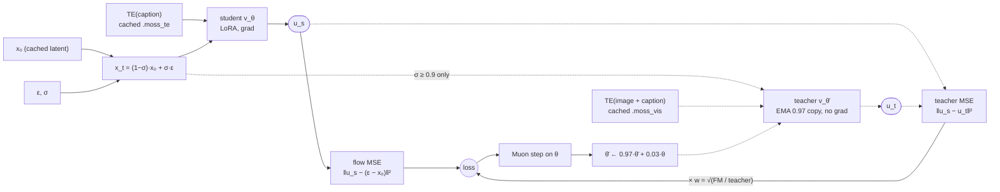
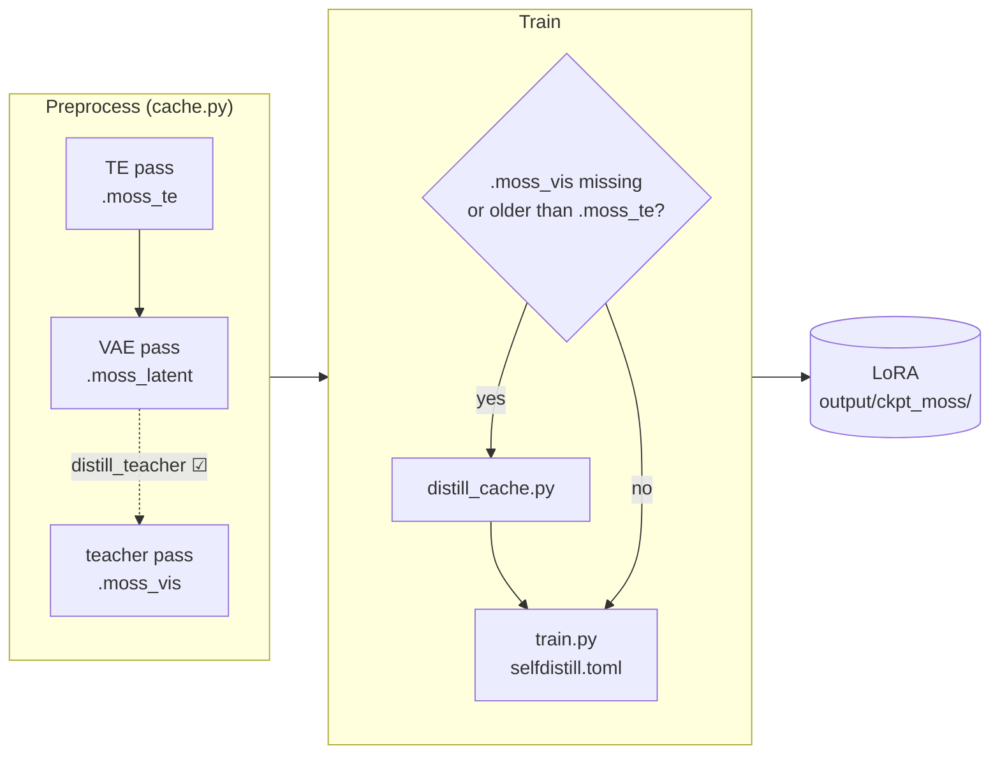

# Self-distilled LoRA (add90 ema97)

Status: experimental, 2026-11-09. One artist (caststation, 30 images), one seed per prompt.
Config: `configs/moss/selfdistill.toml`. Research log, every arm and the open questions:
[`docs/moss/proposal/self_distill_lora.md`](../proposal/self_distill_lora.md).

A t2i LoRA trained with the plain flow loss plus a teacher term at high noise. The teacher is
the same DiT with an EMA copy of the LoRA, given the training image through Qwen3.5-9B's vision
tower ahead of the caption. With the image in context, MOSS reproduces the composition, outfits
and layout of the target zero-shot ([vision_tower_reference.md](../findings/vision_tower_reference.md)),
so its velocity at high σ is a cleaner target for "what goes where" than the one-sample flow
target `ε − x₀`.

Against a plain LoRA (SFT) on the same data and steps, it gives up a little style strength and is
much steadier on general prompts and on held-out multi-character prompts, where it keeps Base's
composition and SFT rearranges the figures.

## The recipe



Solid edges run on every step; dotted ones only on the ~21 % of steps with σ ≥ 0.9. The weight
`w` puts both terms' gradients on the prediction at the same norm (unscaled, the teacher MSE is
~1/40 of the flow MSE).

Where the teacher acts, by σ:

| σ | 0.1 | 0.25 | 0.4 | 0.6 | 0.8 | 0.95 |
|---|---|---|---|---|---|---|
| ‖v(image + caption) − v(caption)‖², Base | 0.0041 | 0.0026 | 0.0018 | 0.0018 | 0.0029 | **0.0187** |
| loss | flow | flow | flow | flow | flow | **flow + teacher** |

Below σ 0.8 `x_t` already holds most of the image, so the image in the TE changes the velocity
little; at σ 0.95 the gap is ~10× larger. That is where the teacher has something to teach
(probe: `bench/moss_self_distill/results/20261109-1638-caststation/`).

| Key | Value | What it does |
|---|---|---|
| `distill` | `ema` | teacher = an EMA shadow of the LoRA (`base` = the LoRA at multiplier 0) |
| `distill_ema_decay` | `0.97` | the teacher trails the student by ~33 updates and carries its style |
| `distill_sigma_min` | `0.9` | the teacher forward and term only on steps with σ ≥ 0.9, ~21 % of steps |
| `distill_add` | `1.0` | keep the flow loss and add the teacher MSE, balanced to the same gradient norm on the prediction |
| `epochs` | `16` | 480 steps on 30 images; judge at this length, 240 steps is ambiguous |
| `lr` | `1e-4` | Muon, as the caststation runs |
| `ema_window` | `0.139` | the saved adapter EMA (separate from the teacher's) |

Everything else is `configs/moss/lora.toml`'s default: int8 Base, fp32 stream, rank 32, Muon.

Why these and not the other arms (details in the proposal):

- A **Base** teacher (`distill base`) cleans figures but pulls the palette and gloss toward Base
  the more steps it gets. The EMA teacher holds the LoRA's own style.
- **Replacing** the flow target on teacher steps (`distill_add 0`) works at σ ≥ 0.9 too
  (hybrid90), but at 480 steps it broke a pose and put a branch across a face; adding to it did
  not.
- The teacher at **every σ** (pure distillation) carries less style: below σ 0.8 `x_t` already
  holds most of the image, so the teacher–student gap there is small.

## Running it



The teacher embeds, `{stem}.moss_vis.safetensors` beside each TE file, are the training image at
the latent's size (~1 vision row per 32² px) followed by every caption the student can draw
(full, plain, variants), through Qwen3.5-9B with its vision tower. They are stamped with the
captions, source, encoder and tail, and only changed files re-encode.

**GUI** (`make gui-moss`, or `make gui` in MOSS mode):

1. **Preprocess**: tick **distill_teacher** to write the teacher embeds after the TE and VAE
   passes (same `text_encoder` as the TE pass). Optional, see step 3.
2. **Train**: set **Recipe** to *Self-distill (selfdistill.toml)*. That writes the keys above into
   the form and resets the keys the other recipes set to their defaults; `cache`, `output`,
   `model` and the int8 / bf16 plan stay. The Recipe item follows the form: `distill` set to
   anything but `off` under Advanced shows Self-distill too.
3. **Train** checks the cache first: when a sample's teacher file is missing or older than its TE
   file (a re-caption rewrites the TE file), it queues `distill_cache.py` ahead of training, with
   the TE weights stamped on the cache. "Preprocess, then train" queues it unless
   distill_teacher is ticked.

**CLI**:

```bash
make daemon-run ARGS="--stall-timeout 900 scripts/moss/cache.py \
  --src <folder> --out post_image_dataset/moss/<set> --distill_teacher"
make daemon-run ARGS="--stall-timeout 900 scripts/moss/train.py \
  --config configs/moss/selfdistill.toml \
  --cache post_image_dataset/moss/<set> --output output/ckpt_moss/<name>.safetensors"
```

On a cache that already exists, `scripts/moss/distill_cache.py --cache post_image_dataset/moss/<set>`
writes the teacher embeds alone (`--text_encoder fp8|bf16` when the TE pass did not use int8).
Training stops with a message when a sample has no teacher file. It does not check the stamp, so
re-run the teacher pass after a re-caption (the GUI's Train does this).

The output is an ordinary LoRA: `generate.py`, the GUI's Test and the ComfyUI MOSS nodes load it
as any other. Its metadata stamps the `distill*` keys.

## Cost

caststation, 30 images (~4,100 image tokens), int8 Base, fp32 stream, 16 GB card:

| | s/step | peak allocated | 480 steps |
|---|---|---|---|
| SFT | 1.07 | 13.19 GB | 8.5 min |
| hybrid90 (Base teacher) | 1.13 | 13.20 GB | 9.1 min |
| add90 ema97 | 1.15 | 13.75 GB | 9.2 min |

The EMA teacher's shadow and its scratch copy add ~0.55 GB over a Base teacher. Teacher cache:
about a minute for 30 images after the TE loads. The compile range spans the teacher's longer
token axis (vision rows ahead of the caption; caststation 4,192–5,613 tokens).

## Results (caststation, 480 steps)

Renders: `output/tests/caststation_distill_ab/e16/` (`sheet.png`, `sheet_space004.png`); int8,
CFG 3, 50 steps, the three caststation prompts × seeds 1–6.

| LoRA | style strength | caststation prompts | held-out Space 004 (12 characters) |
|---|---|---|---|
| SFT | strongest | smeared phone hand (s5), stray flower crown (s6) | composition drifts from Base, more than at 240 steps |
| hybrid90 (replace at σ ≥ 0.9) | not compared | broken bench and pose (s3), branch across a face (s6) | keeps Base's layout |
| **add90 ema97** | a little lighter | no broken cell; general prompts s3 / s6 clean | keeps Base's layout |

Flow loss over the last 120 steps: SFT 0.2472, hybrid90 0.2488, add90 ema97 0.2509. The loss does
not rank these arms; the renders do.

## When to use it

- The LoRA should hold up on prompts unlike its training captions, or on scenes with several
  characters: the high-σ teacher term keeps Base's composition there.
- When the strongest style transfer is the goal, plain LoRA still has the edge.

## Limits

- Tested on one artist set. Character sets, other styles and i2i are untested.
- Refused with `delta_rows` other than `all`, `trigger_registers` and `ref_adapters all`: their
  row masks are built for the student's sequence, and the teacher's has the image rows ahead of
  the caption. So it does not combine with the trigger-registers recipe.
- `distill_extra_sigma` with `repa_weight` is refused (both use the capture hook).
