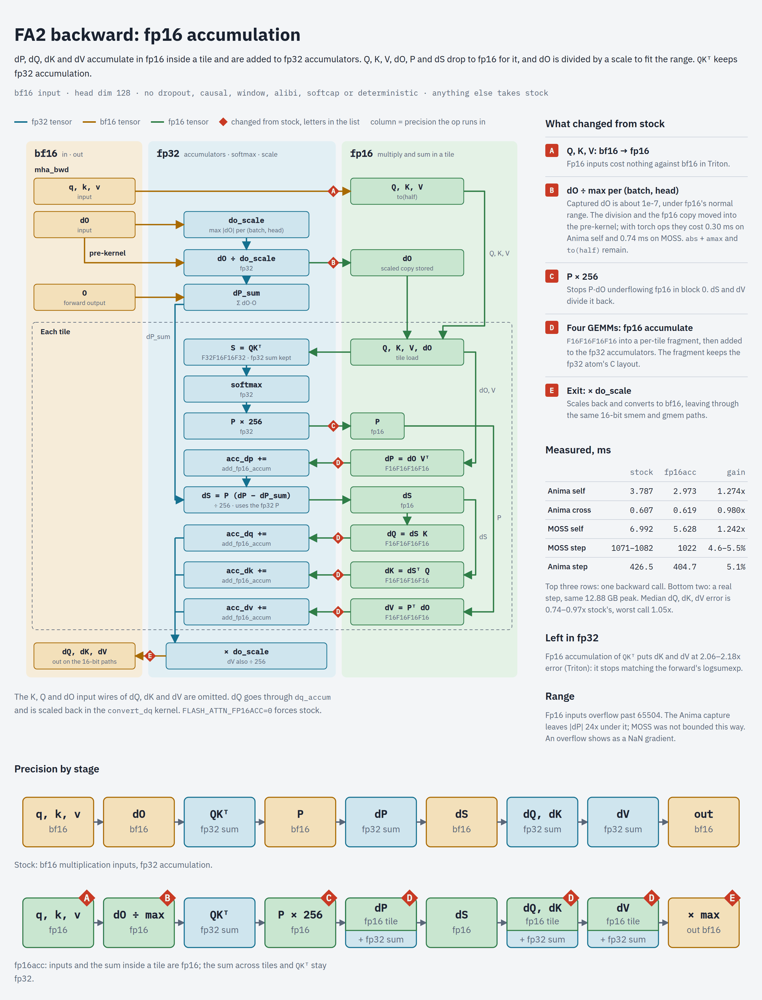

# FlashAttention build for sm_120

Repo jobs on an RTX 50-series card run a patched FlashAttention 2.8.3 for MOSS-Image and Anima. It
holds three changes: an fp16-accumulate backward, about 5% of a training step, the 128×32 forward
tile, 0.7%, and on Linux an fp16-accumulate PV forward, about 4% of a MOSS render. Peak VRAM stays
the same, and attention gradients land closer to fp32 than stock's.

| change | gain | error | detail |
|---|---|---|---|
| Forward tile 128×32 | 0.7% of a step | unchanged | [finding](../findings/fa2_tile_sm120.md) |
| fp16-accumulate backward | MOSS 4.6–5.5%, Anima 5.1% | dQ, dK, dV 0.74–0.97x stock | [report](../../../project/finished/int8_train/reports/fa2_fp16acc.md) |
| fp16-accumulate PV forward (Linux) | MOSS 1024² render 10.6–10.9 → 10.3 s; forward call 1.15x | O, dQ, dK, dV 0.96–1.00x bf16 | [report](../../../project/finished/int8_train/reports/fa2_fwd_fp16acc.md) |

The int8 GEMMs are the other custom kernels in the step. They ship in `comfy_kitchen`, not in this
build: [int8.md](int8.md), [training_step.md](training_step.md).

## Install

On Linux x86_64 or Windows ([installation guide §5](../../installation/README.md#5-rtx-50-series-patched-flashattention-optional)):

```bash
uv sync --no-default-groups --group fa2-sm120
```

The `fa2-sm120` group is the default torch 2.14 stack with this wheel in place of the pin. It
reaches everything on the venv: ComfyUI and Qwen's `flash_attention_2` text encoder get the build
too, and there any head dim but 64 and 128 raises. Any card but sm_120 has no kernel to run, so use
the group on an RTX 50-series box only. A flagless `uv sync` puts the pin back;
`ANIMA_TORCH=2.14-sm120 make update` saves the choice for later updates. On aarch64 the group keeps
the stock wheel.

The build holds head dims 64 and 128 only, and any other head dim raises. 64 is Anima's `llm_adapter`,
which runs the stock backward. A torch minor bump needs a new wheel. Source: patches and `build.sh`
in `sorryhyun/flash-attention-fp16`; Linux x86_64 and Windows take the same release (`TAG` in
`library/runtime/fa2.py`).

## The fp16-accumulate backward



GeForce cards run fp16 accumulation at twice fp32's rate, but only with fp16 inputs: the bf16 MMA is
`f32.bf16.bf16.f32` alone in CUTLASS's sm80 header. So the kernel moves its inputs to fp16:

- **Q, K, V** go to fp16 (`to(half)`).
- **dO** is divided by its max per (batch, head) in the pre-kernel, which also stores the fp16 copy.
  Captured dO is about 1e-7, under fp16's normal range.
- **P** is stored × 256, so P·dO does not underflow in block 0. dS and dV divide it back.
- **dP, dV, dQ, dK** run `F16F16F16F16` into a per-tile fragment, added to fp32 accumulators.
- **dQ, dK, dV** are scaled back and leave as bf16 through the same 16-bit paths.

`mha_bwd` takes this path for bf16 input at head dim 128 with no dropout, causal, window, alibi,
softcap or `deterministic`, and `num_heads_k == num_heads`. Anything else takes stock.
`FLASH_ATTN_FP16ACC=0` forces stock in-process.

## What stays out of fp16

- **QKᵀ keeps fp32 accumulation.** In fp16 it alone puts dK and dV at 2.06–2.18x error, because the
  logits stop matching the forward's logsumexp and dS is a difference of near-equal terms. Moving the
  forward's QKᵀ to fp16 too gives about 1.7–1.9x and 7% more speed in Triton; keeping fp32 cost that
  7% for a third of the error.
- **The forward's QKᵀ stays on fp32 accumulation.** PV runs in fp16 accumulation inside each 32-key
  tile for bf16 head dim 128 calls with at least 1024 keys; under that the fp16 casts of Q, K and V
  cost more than it saves. `FLASH_ATTN_FP16ACC_FWD=0` takes the bf16 forward, `=all` adds QKᵀ in fp16
  in the forward and the backward (forward 1.35x, dK and dV at 1.5–1.7x error).
- **The gradients at the kernel's boundary stay bf16.** dO coming in and dQ, dK, dV going out are too
  small for fp16 without the kernel's scale.
- **int8 outputs stay bf16.** On the fp32 stream, fp32 outputs lower Anima's prediction error by only
  2–8%, and that is the upper bound for fp16 ([attribution](../../../project/finished/int8_train/reports/anima_stream_attrib.md)).

## Measured

RTX 5070 Ti, ms per call:

| | q | forward | stock bwd | fp16acc bwd | bwd |
|---|---|---|---|---|---|
| Anima self | `[1, 4131, 16, 128]` | 1.490 | 3.787 | 2.973 | 1.274x |
| Anima cross | `[1, 4131, 16, 128]`, Lk 512 | 0.190 | 0.607 | 0.619 | 0.980x |
| MOSS self, random input | `[1, 4600, 24, 128]` | 2.667 | 6.992 | 5.628 | 1.242x |

Real step, same build with the flag off and on:

| | stock | fp16acc | peak |
|---|---|---|---|
| MOSS, `configs/moss/lora.toml`, `hews_layout` | 1071–1082 ms | 1022 ms | 12.88 GB, same |
| Anima, `--int8 full`, `--method lora --preset default` | 426.5 ms | 404.7 ms | |

MOSS's LoRA gradient keeps its distance from fp32 (1.000–1.005x).

Whole LoRA, `configs/moss/lora.toml` on `channel_(caststation)_layout`, 240 steps, same seed:

| | stock | fp16acc |
|---|---|---|
| epochs 2–8, median per step | 1.119 s | 1.067 s (4.6%) |
| peak allocated | 13.21 GB | 13.21 GB |
| last epoch's loss | 0.2848 | 0.2842 |

swap_text i2i, `train_v3_en200_ko800.toml` (swap 38, budget 0.1), first 100 steps, same seed: 2.713 →
2.553 s/step (5.9%), same 12.72 GB peak, mean loss 0.2889 and 0.2887.

Six same-noise renders of the two LoRAs show no artifact on either side and were not scored. FA2 is
non-deterministic (stock alone repeated at `|g|` 0.145 and 0.105), and there is no stock-against-stock
floor to read their pixel difference against.

## Range

fp16 inputs overflow past 65504. On the Anima capture |V| peaks at 95 and Σ|V| per row at 2697, which
bounds |dP| 24x under that. MOSS peaks at |V| 304 and Σ|V| 9075, 7.2x under;
over 24 real steps, 91 sampled calls, |dP| reached 1812 (36x), and dQ and dK per tile 1069 and 1606
(61x, 41x). An overflow gives a NaN gradient, not a quiet error; none appeared in the runs above.

## Left on the table

The backward kernel runs the tensor pipe 74% of the time against stock's 91%: the fp16 partials are
drained into fp32 every tile, and that `cvt` + `fadd` work is not hidden with two warps per scheduler.
Draining every second tile ran slower (the partial chains one tile's HMMA on the last), so the kernel
stays as it is; the backward's three casts and the `abs` temporary were removed instead
([report](../../../project/finished/int8_train/reports/fa2_fp16acc.md#where-the-2x-went-2026-11-04)).
