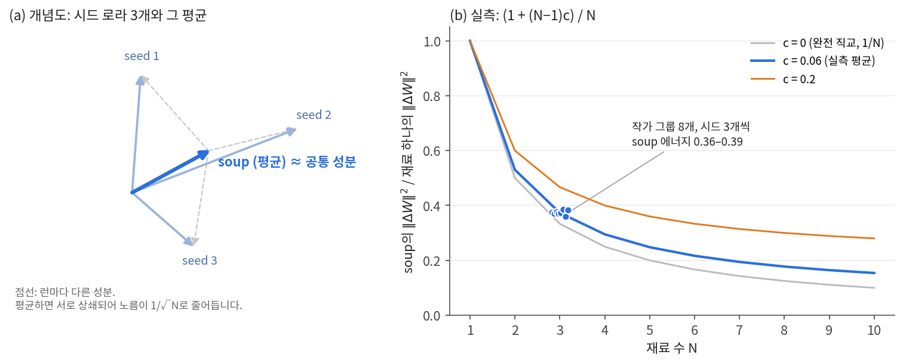
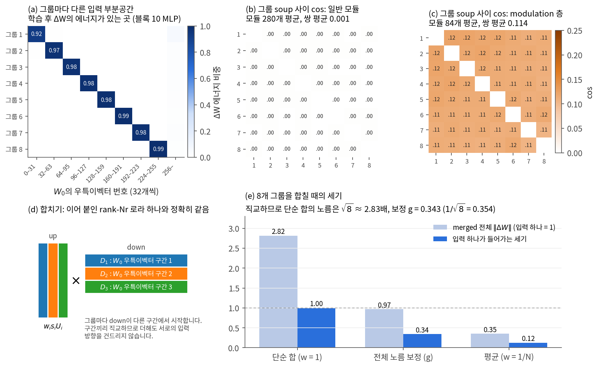

# 2. LoRA soup과 merge: 여러 LoRA를 하나로

## 1. LoRA soup: 불운을 피하기

### 1.1 시드의 중요성

디퓨전 모델 학습에서는 학습 시드가 생각보다 많은 것을 좌우합니다. [출처](https://arxiv.org/abs/2606.20536) 시드만 다른
로라를 PE-Core로 CMMD(MMD², 낮을수록 좋음)를 측정했을 때 아래와 같은 결과가 나옵니다.

| 런 | CMMD |
|---|---|
| seed 1 / 2 / 3 | 0.46 / **1.02** / 0.49 |
| 세 런의 rank-16 SVD soup | **0.469** |

실제 작품끼리 잰 real-vs-real 노이즈 바닥은 0.155입니다.

그렇다면 좋은 시드를 골라 다시 돌리면 되지 않을까 싶지만, 그것도 통하지 않습니다. 시드, 데이터 순서, σ, noise를
모두 동일한 학습조차 ΔW 코사인이 1200스텝 기준 0.41에 그쳤습니다. FlashAttention backward가 dK, dV를 atomic add로
누적하는 순서와 compile한 graph의 bf16 반올림은 시드로 고정되지 않고, 이 작은 차이를 학습이 키우기 때문입니다. 즉,
좋은 시드를 찾아 정확히 재현하고 고정하려는 건 배보다 배꼽이 더 큰 작업이므로, 더 단순한 방법으로 우회했습니다.

### 1.2 서로 다른 시드 로라를 평균내기

이를 완화하는 제일 간단하고 효과적인 방법은 model soup(Wortsman et al. 2022, arXiv 2203.05482)이고, 여기서는 각 시드
로라 평균을 LoRA의 ΔW에 적용합니다.

N개 재료를 평균하면

$$
\Big\|\tfrac1N\textstyle\sum_i \Delta W_i\Big\|_F^2=\tfrac1{N^2}\Big(\sum_i\|\Delta W_i\|_F^2+2\sum_{i<j}\langle\Delta W_i,\Delta W_j\rangle_F\Big)
$$

이므로, 재료의 노름이 비슷하고 쌍별 cos가 c이면 soup 에너지는 재료 하나의 (1 + (N−1)c)/N배입니다. 공통 성분은
그대로 남고, 런마다 다른 성분은 노름 기준 1/√N으로 줄어듭니다. 337장 그룹에서 soup의 ‖ΔW‖²는 재료 평균의
0.384배였고, c ≈ 0.085로 계산한 (1 + 2c)/3 ≈ 0.39와 맞습니다.

(a) 시드만 다른 로라는 공통 성분에 런마다 다른 성분(점선)이 더해진 것이고, 평균하면 런마다 다른 성분이 서로
상쇄됩니다. (b) 작가 그룹 8개에서 각각 시드 3개로 만든 soup의 에너지입니다. 재료끼리의 cos는 0.03–0.09(평균
0.06)이고, 8개 모두 각자의 c로 계산한 (1 + 2c)/3과 맞습니다.

### 1.3 인자를 평균하면 틀어진다

A(down)와 B(up)를 따로 평균하면 두 가지가 틀어집니다.

1. `avg(B) @ avg(A) ≠ avg(B @ A)`.
2. down을 W₀의 SVD로 초기화하면 특이벡터의 부호가 런마다 달라질 수 있어서, A를 행 단위로 평균하면 행이 서로
   지워질 수 있습니다.

ΔW는 (A, B)를 어떻게 다시 매개화하든 변하지 않습니다. 그리고 rank-r ΔW들의 가중합은 블록을 이어 붙인 rank-Σr
LoRA 하나로 **정확히** 쓸 수 있습니다. sᵢ = αᵢ/rᵢ는 LoRA의 scale입니다(Hu et al. 2021, arXiv 2106.09685).

$$
\Delta W=\sum_i w_i\,s_i\,U_iD_i=\big[\,w_1s_1U_1\;\big|\;w_2s_2U_2\;\big|\cdots\big]\begin{bmatrix}D_1\\ D_2\\ \vdots\end{bmatrix},\qquad s_i=\alpha_i/r_i
$$

wᵢ·sᵢ를 up에 접고 down과 up을 이어 붙인 뒤, 결과의 alpha를 rank(Σrᵢ)로 둬서 scale을 1로 만듭니다. 그러면
multiplier 1.0이 Σ wᵢΔWᵢ가 되고, soup은 wᵢ = 1/N인 경우입니다.

---

## 2. 서로 다른 LoRA를 하나로

서로 다른 작업의 ΔW를 더해 한 모델에 여러 능력을 넣는 방법은 task arithmetic(Ilharco et al. 2022, arXiv
2212.04089)입니다. 계산은 §1.3의 concat과 같고, soup과는 다음이 다릅니다.

| | soup | merge |
|---|---|---|
| 기본 가중치 | 1/N (평균) | 1.0 (합) |
| 모듈 집합 | 모든 재료가 같아야 함 | 합집합. 일부 입력에만 있는 모듈은 그 입력의 블록만 들어감 |
| SVD truncation | 선택 | 없음. 항상 concat |
| 크기 보정 | 없음 | 전체 노름을 스칼라 하나로 맞춤 (§2.1) |
| modulation 층 | 다른 층과 같음 | 평균 (§2.2) |

TIES-merging(Yadav et al. 2023, arXiv 2306.01708)은 겹치는 ΔW 사이의 부호 충돌을 줄이는 방법인데, 작가
그룹끼리 cos가 거의 0이라 충돌할 성분이 없으므로 그대로 더합니다.

(a) 그룹 k의 down은 W₀ 우특이벡터의 k번째 구간(32개)에서 시작합니다. 학습이 끝난 뒤에도 각 그룹 ΔW 에너지의
92–99 %가 자기 구간에 남아 있습니다. (b) 그래서 그룹 soup끼리의 cos는 일반 모듈에서 0에 가깝습니다. (c)
modulation 층은 모든 그룹이 같은 init에서 시작하므로 0.11–0.12씩 겹칩니다(§2.2). (d) 합친 결과는 up과 down을 이어
붙인 로라 하나와 정확히 같습니다(§1.3). (e) 직교하는 8개를 그냥 더하면 노름이 √8배가 됩니다. 전체 노름 보정(§2.1)을
하면 노름이 입력 하나의 수준으로 돌아오고, 입력 하나는 단독 세기의 0.34배로 들어갑니다. 평균하면 0.125배입니다.
그림의 값은 4번 그룹을 다시 학습한 현재 8개 그룹에서 쟀기 때문에 부록 A2.4의 표(일반 모듈 0.0003, modulation
층 0.126)와 조금 다릅니다.

### 2.1 전체 노름 맞추기

거의 직교하는 ΔW N개를 그냥 더하면 노름이 √N배로 커져 DiT를 과구동합니다. 그래서 모듈 m마다 target_m = 입력별
‖sᵢ·Uᵢ·Dᵢ‖의 평균(가중치 w는 넣지 않은 값)을 구하고, 다음 스칼라를 modulation 층을 뺀 모든 모듈에 곱합니다.

$$
g=\sqrt{\frac{\sum_m \text{target}_m^2}{\sum_m \|\Delta W^{merged}_m\|_F^2}}
$$

- 입력이 서로 직교하고 노름이 같으면 g = 1/√N이고, 노름이 고르지 않으면 1/√N보다 작습니다. 그러면 입력 하나는
  단독 세기의 약 1/√N배로 들어가는데, 평균(1/N)보다 √N배 셉니다.
- target에 w가 들어가지 않으므로 입력별 가중치는 **입력 사이의 비율만** 정합니다. 가중치 전체를 몇 배 하든
  결과는 같습니다. 절대 세기를 정하려면 이 보정을 끕니다.
- 모듈마다 따로 맞추면 층 사이 비율이 바뀝니다. 스칼라 하나를 쓰면 층 사이 비율이 유지됩니다.

### 2.2 modulation 층은 평균한다

DiT의 modulation 층(Anima에서는 adaLN)은 timestep 임베딩만 입력으로 받습니다. 그래서 이 층의 ΔW는 모든 이미지에
똑같이 걸리는 채널별 shift/scale/gate 편향이 됩니다. Anima에서는 이 입력이 σ ∈ [0, 1]에서 거의 일정하고(평균과의
cos ≥ 0.99) 에너지의 73 %가 W₀의 첫 번째 우특이벡터에 있습니다. 그래서 modulation 층은 그룹마다 다른 특이벡터
구간을 쓰지 않고, 모든 그룹이 같은 init에서 시작합니다. 8개 그룹의 soup을 서로 재 보면 일반 모듈은 직교하지만(cos 평균 0.0003) modulation 층은 겹칩니다(cos 평균
0.126, 부록 A2.4).

일반 모듈은 그룹마다 다른 입력 부분공간에 있어서 더해도 서로 간섭하지 않습니다. 반면 modulation 층은 같은
init에서 출발한 전역 편향 N개라 일부가 겹치고, 그대로 더하면 공통 성분이 그룹 수만큼 쌓입니다. 그래서 가중
평균(wᵢ / Σw)으로 합치고 §2.1의 보정에서는 뺍니다.
